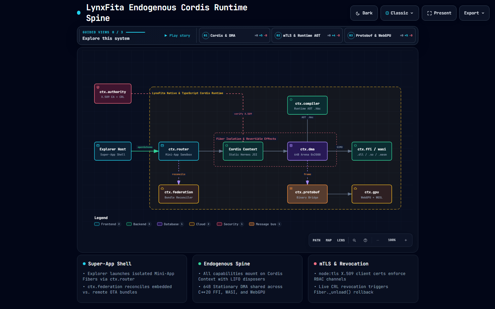
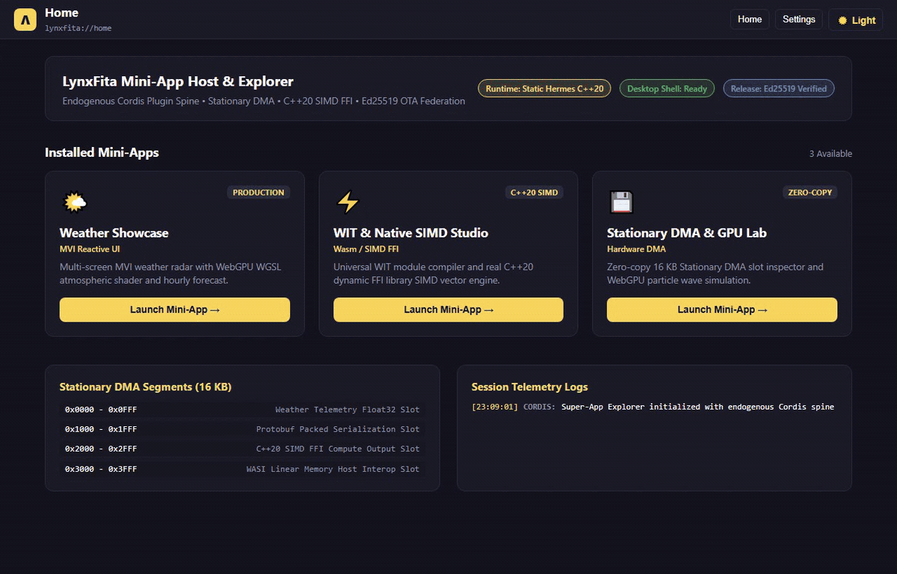
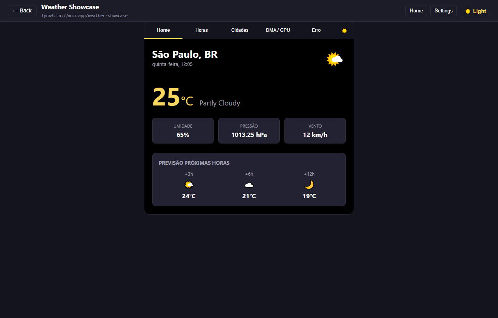
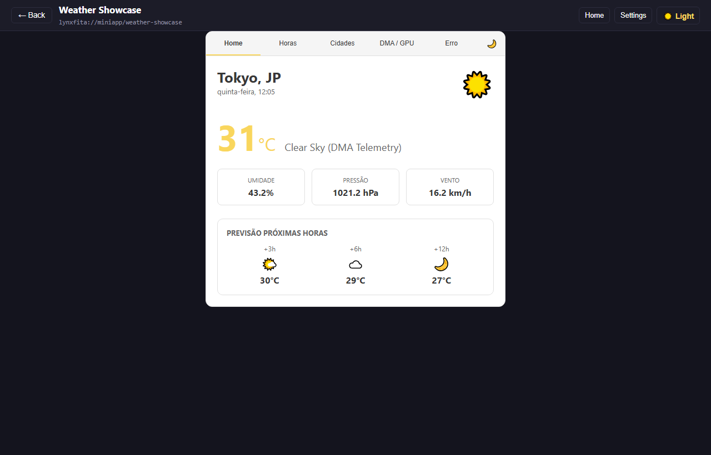
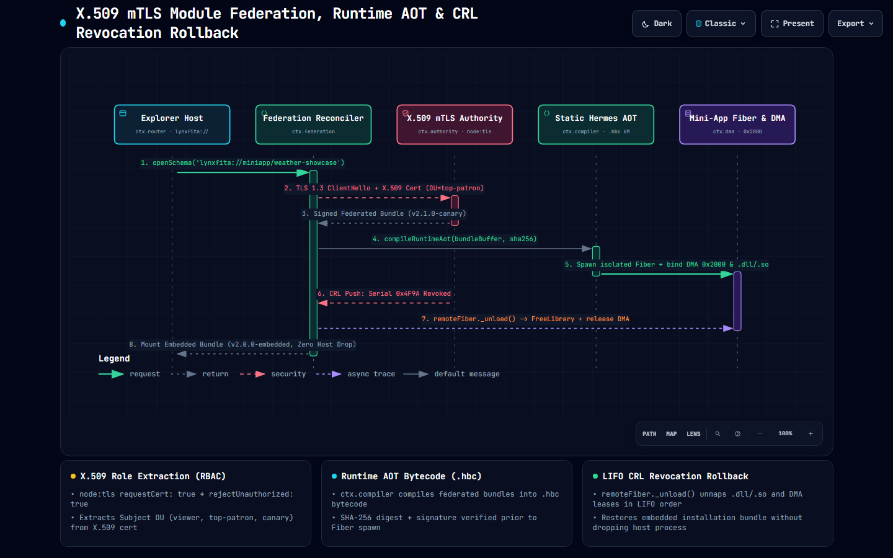

<div align="center">

# LynxFita

**Cordis-Powered Native Desktop & Embedded Runtime for LynxJS**

*Static Hermes (`static_h`) &bull; C++20 JSI & Dynamic `.dll`/`.so` FFI &bull; WIT/WASI Components &bull; 64B Stationary DMA &bull; X.509 mTLS Module Federation*

[](https://opensource.org/licenses/Apache-2.0)
[](https://github.com/aleffita/lynxfita/actions)
[](https://en.cppreference.com/w/cpp/20)
[](https://pnpm.io/)
[](https://github.com/meta/hermes/tree/static_h)
[](https://arxiv.org/abs/2608.25512)
[](https://donate.stripe.com/9B66oHaordEdf36erNfEk00)
[](https://github.com/sponsors/aleffita)

<br />

<picture>
  <source media="(prefers-color-scheme: light)" srcset="docs/assets/cordis-spine-light.png" />
  
</picture>

</div>

---

## 1. Overview & Endogenous Cordis Architecture

**LynxFita** replaces the Node.js + IPC JSON bridge in LynxJS desktop hosts with a unified, all-plugin runtime built on **Static Hermes (`static_h`)**, **C++20 JSI**, **64-byte-aligned Stationary DMA**, and **[Cordis](https://github.com/shigma/cordis)** ([`vendor/cordis`](vendor/cordis), [arXiv:2608.25512](https://arxiv.org/abs/2608.25512)).

Every runtime capability—across both the TypeScript control plane (`LynxFitaContext`) and the C++20 native engine (`lynxfita::cordis::NativeContext`)—is mounted as a Cordis **Service** with explicit `inject` coeffects and revertible `ctx.effect()` disposers:

| Capability Seam | TypeScript Service | C++20 Native Service | Contract |
| :--- | :--- | :--- | :--- |
| **`ctx.dma`** | `DmaService` (`@lynxfita/core`) | `StationaryDmaArena` (`stationary_dma.cc`) | 64-byte-aligned Stationary DMA arena (`0x0000` weather telemetry, `0x1000` Protobuf wire, `0x2000` SIMD FFI output, `0x3000` WASI linear memory) + PPE/SPE ring lanes. |
| **`ctx.protobuf`** | `ProtobufService` (`@lynxfita/core`) | `ProtobufWireCodec` (`protobuf_frame.cc`) | Zero-JSON binary wire framing (`tag << 3 \| wire_type`) directly over Stationary DMA slots. |
| **`ctx.compiler`** | `CompilerService` (`@lynxfita/core`) | `HermesBytecodeCompiler` (`hermes_compiler.cc`) | Ahead-of-time and runtime JIT/AOT `.hbc` bytecode compilation + stack/register VM execution over DMA and host functions. |
| **`ctx.ffi`** | `FfiService` (`@lynxfita/core`) | `NativeFfiLoader` (`native_ffi_loader.cc`) | Cross-platform dynamic shared library loader (`LoadLibraryExW` on Win32, `dlopen` on Linux/macOS) with automatic `FreeLibrary`/`dlclose` on `Fiber._unload()`. |
| **`ctx.wasi`** | `WasiComponentService` (`@lynxfita/wasi-runtime`) | `WasiHostModule` (`wasi_host_module.cc`) | WIT (WebAssembly Interface Types) universal module IR (`@lynxfita/codegen`) + LEB128 Wasm binary parser and stack machine bound to Stationary DMA. |
| **`ctx.gpu`** | `GpuService` (`@lynxfita/core`) | — | W3C WebGPU two-buffer staging (`MAP_READ` / `COPY_DST`), WGSL compute shaders, and `huggingface/kernels` catalog dispatch. |
| **`ctx.authority`** | `MtlsAuthorityServer` (`@lynxfita/updater`) | — | Real `node:https` / `node:tls` X.509 mTLS Authority Server (`requestCert: true`), role-bearing client certificates (`viewer`, `top-patron`, `canary`), and live Certificate Revocation List (CRL). |
| **`ctx.federation`** | `FederationService` (`@lynxfita/updater`) | — | Reconciles embedded installation bundles (`1.0.0-embedded`) against remote federated bundles (`2.1.0-stable`, `2.2.0-canary-patron`) and unloads child Fibers on live CRL revocation. |

> Interactive architecture diagrams: [`docs/architecture/cordis-spine.html`](docs/architecture/cordis-spine.html) &bull; [`docs/architecture/mtls-federation.html`](docs/architecture/mtls-federation.html) &bull; [`docs/cordis-primer.md`](docs/cordis-primer.md)

---

## 2. WeChat-Style Super-App Explorer & Showcases

In LynxFita, **the Explorer IS the Super-App** (modeled on WeChat Mini-Program containers, [`vendor/lynx/explorer`](vendor/lynx/explorer), and [`vendor/sparkling`](vendor/sparkling)). Each Mini-App launches via `lynxfita://miniapp/<id>` inside an isolated child Cordis Fiber (`ctx.isolate()`), acquiring DMA and FFI resources through `ctx.effect()` and unwinding them in LIFO order on navigation back or certificate revocation.

<div align="center">
  
</div>

| Mini-App / Host Target | Path | Capabilities Demonstrated |
| :--- | :--- | :--- |
| **Super-App Explorer Host** | [`examples/explorer`](examples/explorer) | Scheme router (`lynxfita://home`, `lynxfita://settings`, `lynxfita://miniapp/*`), isolated Cordis Fiber container manager, live DMA segment telemetry, X.509 mTLS identity switcher, and interactive HTTP server (`pnpm explore` at `http://127.0.0.1:4173`). |
| **Weather Showcase MVI** | [`examples/weather-showcase`](examples/weather-showcase) | Multi-screen MVI port of [`aleffita/weather-showcase`](https://github.com/aleffita/weather-showcase) (`forecast-home`, `hourly-detail`, `city-search`, `shader-dma-inspector`, `location-error-boundary`), Dark/Light themes (`#f9d65d`), all 14 OpenWeatherMap icon mappings, and WGSL wave shaders bound to DMA `0x2000`. |
| **WIT & Native SIMD Studio** | [`examples/explorer/src/miniapps/wit_ffi_studio_miniapp.ts`](examples/explorer/src/miniapps/wit_ffi_studio_miniapp.ts) | Interactive WIT interface parser (`parseWitSpec`), universal IR code generator, and zero-copy SIMD advection execution over DMA `0x2000`. |
| **Stationary DMA & GPU Lab** | [`examples/explorer/src/miniapps/dma_gpu_lab_miniapp.ts`](examples/explorer/src/miniapps/dma_gpu_lab_miniapp.ts) | Live 16 KB Stationary DMA slot visualizer (`0x0000`–`0x3FFF`), raw hex memory inspector, and 60 FPS atmospheric wave particle canvas. |
| **`lynxfita_explorer` Native Host** | [`src/native/src/explorer_main.cc`](src/native/src/explorer_main.cc) | Self-contained C++20 executable supporting Win32 desktop GUI window (`--gui`), `.hbc` bytecode execution (`--run`), and automated Super-App navigation verification (`--verify-navigation`). |

<p align="center">
  
  
</p>

---

## 3. X.509 mTLS Module Federation & Live CRL Rollback

<div align="center">
  <picture>
    <source media="(prefers-color-scheme: light)" srcset="docs/assets/mtls-federation-light.png" />
    
  </picture>
</div>

1. **Cryptographic X.509 RBAC (`ctx.authority`)**: `packages/updater/src/x509.ts` and `authority_service.ts` generate ASN.1 DER X.509 v3 Root CA, Server, and role-bearing Client certificates (`OU=viewer`, `OU=top-patron`, `OU=canary`) verified by `node:crypto.X509Certificate` and `node:https` (`requestCert: true`).
2. **Bundler Module Federation (`ctx.federation`)**: Reconciles the embedded installation bundle (`1.0.0-embedded`) against signed remote federated bundles (`2.1.0-stable` or `2.2.0-canary-patron`), compiling remote payloads into `.hbc` bytecode via `ctx.compiler` before mounting the child Fiber.
3. **Deterministic CRL Revocation Rollback**: When a client certificate serial is added to the live Certificate Revocation List (`revokeCertificate(serial)`), `ctx.federation` invokes `remoteFiber._unload()`—calling `FreeLibrary`/`dlclose` on native plugins and releasing DMA slots—and restores the embedded baseline bundle without dropping the Explorer host process.

---

## 4. Statistical Performance Benchmarks (Kalibera & Jones Methodology)

Measured via `pnpm bench` ([`benchmarks/run_benchmarks.ts`](benchmarks/run_benchmarks.ts)) using 10 discarded warm-up rounds followed by $N = 30$ independent sample batches per regime on `AMD Ryzen 5 4500 6-Core Processor` (`Windows_NT 10.0.19045 x64`, `Node.js v26.12.1`). Full report: [`BENCHMARK.md`](BENCHMARK.md).

| Subsystem / Benchmark | Payload | $p50$ ($\mu\text{s}$) | IQR ($\mu\text{s}$) | $p95$ ($\mu\text{s}$) | $p99$ ($\mu\text{s}$) | Mean $\pm$ 95% CI ($\mu\text{s}$) | Throughput (MB/s) |
| :--- | :--- | :---: | :---: | :---: | :---: | :---: | :---: |
| **Stationary DMA Transfer** | `64 B` | `0.60` | `0.00` | `1.20` | `2.20` | `0.70 ± 0.10` | `88.46` |
| **Stationary DMA Transfer** | `4 KB` | `0.60` | `0.00` | `1.00` | `1.10` | `0.60 ± 0.00` | `6,135.47` |
| **Stationary DMA Transfer** | `64 KB` | `1.60` | `0.00` | `1.80` | `2.00` | `1.60 ± 0.00` | `38,981.29` |
| **Stationary DMA Transfer** | `1 MB` | `23.10` | `0.20` | `27.40` | `30.70` | `23.50 ± 0.60` | `42,498.94` |
| **SIMD 4-Float Pack/Unpack** | `16 B` | `0.36` | `0.07` | `0.79` | `0.82` | `0.40 ± 0.10` | `38.22` |
| **Protobuf MethodCall Wire** | `64 B` | `7.70` | `2.90` | `16.60` | `17.20` | `9.00 ± 0.90` | `6.80` |
| **Protobuf MethodCall Wire** | `4 KB` | `9.60` | `5.00` | `23.70` | `35.30` | `12.20 ± 2.10` | `319.57` |
| **WASI Linear Memory Interop** | `64 B` | `0.50` | `0.10` | `1.10` | `1.30` | `0.50 ± 0.10` | `117.38` |
| **WASI Linear Memory Interop** | `64 KB` | `21.40` | `3.60` | `31.60` | `32.60` | `21.90 ± 1.40` | `2,851.28` |
| **WASI Linear Memory Interop** | `1 MB` | `285.20` | `85.90` | `472.80` | `631.50` | `306.00 ± 33.60` | `3,268.29` |
| **WebGPU Atmospheric Compute** | `64 B` | `2.90` | `0.20` | `3.60` | `12.20` | `3.20 ± 0.60` | `18.92` |
| **Hermes HBC Bytecode Compiler** | `53 B` | `1.20` | `0.20` | `2.50` | `4.80` | `1.40 ± 0.30` | `36.19` |

---

## 5. Quick Start & Verification Commands

### Prerequisites
- Windows 10/11 (x64), Linux (Ubuntu 22.04+), or macOS (arm64)
- Node.js (v22.6+ with `--experimental-strip-types`) & pnpm (v10+)
- CMake (3.20+) & C++20 compiler (MSVC 2022/2026, Clang 16+, or GCC 13+)

```bash
# 1. Install dependencies & materialize workspace proxies
pnpm install

# 2. Compile all TypeScript workspaces
pnpm build

# 3. Run the full verification pyramid (anti-slop docs gate + 32 unit + integration + E2E tests)
pnpm test

# 4. Build and run the native C++20 engine, dynamic .dll/.so plugin, and 14 native test suites
pnpm test:native

# 5. Launch the interactive WeChat-style Super-App Explorer at http://127.0.0.1:4173
pnpm explore

# 6. Execute Kalibera & Jones N = 30 statistical benchmarks and update BENCHMARK.md
pnpm bench
```

---

## 6. Monorepo Organization & Recursive Governance

Each directory is governed by a local `AGENTS.md` progressive-disclosure indexer:

```
lynxfita/
├── AGENTS.md                # Root standing orders & Cordis capability seam contract
├── BENCHMARK.md             # Reproducible Kalibera & Jones statistical benchmark report
├── .agents/                 # Specialist agent profiles & skills (archify, dsh-prose-standard, record-browser-gif)
├── benchmarks/              # N = 30 statistical benchmark harness & JSON provenance (benchmarks/AGENTS.md)
├── docs/                    # Architecture diagrams, Cordis primer, transcripts & glossary (docs/AGENTS.md)
├── examples/                # Super-App Explorer & multi-screen Weather Showcase MVI (examples/AGENTS.md)
│   ├── explorer/            # WeChat-style Super-App host shell, Mini-Apps & HTTP dev server
│   └── weather-showcase/    # 5-screen MVI weather radar with WGSL shaders & DMA 0x2000 sync
├── packages/                # Pure TypeScript Cordis workspaces (packages/AGENTS.md)
│   ├── core/                # LynxFitaContext, Fiber, Service, Stationary DMA, Protobuf, HBC VM & WebGPU
│   ├── codegen/             # WIT universal module IR parser & typed Cordis/JSI/WASI generator
│   ├── wasi-runtime/        # WASI component service bound to Stationary DMA
│   ├── builder/             # Federated bundle compiler, SHA-256 manifest signer & REPACK packager
│   ├── updater/             # Real node:https X.509 mTLS Authority Server, RBAC & live CRL Federation
│   └── cli/                 # Developer CLI (init, codegen, build, doctor)
├── scripts/                 # Pure TypeScript workspace setup, native build/test, vendor sync & docs verifier
├── src/native/              # C++20 NativeContext, LoadLibraryExW/dlopen FFI, HBC VM, Wasm VM & lynxfita_explorer
├── tests/                   # Cross-package integration & full-lifecycle E2E test suites
└── vendor/                  # 10 zero-fork pinned upstream submodules (cordis, hermes, lynx, kernels...)
```

---

## 7. Backing the Research & Patronage

<div align="center">

### 🖤🐧 *"Enjoyed the session? Satisfied with how I perform?"*

*Help keep a working girl's late-night research alive by tipping any amount. Who knows — I might spin up a private dashboard and unlock exclusive behind-the-scenes builds for my top patrons. No promises, just immeasurable value to keep the sessions going!*

<br />

[](https://donate.stripe.com/9B66oHaordEdf36erNfEk00)&nbsp;&nbsp;&nbsp;[](https://github.com/sponsors/aleffita)

</div>

---

## 8. License

Licensed under the **Apache-2.0 License**. See [LICENSE](LICENSE) for details.
