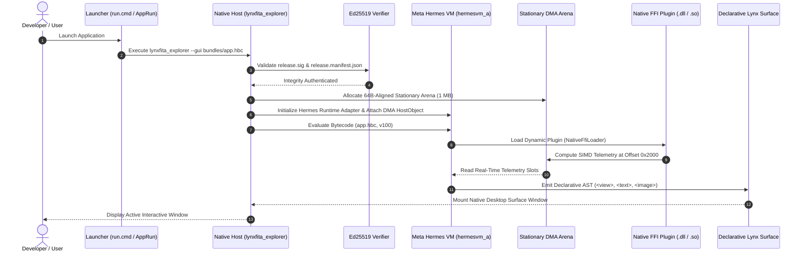
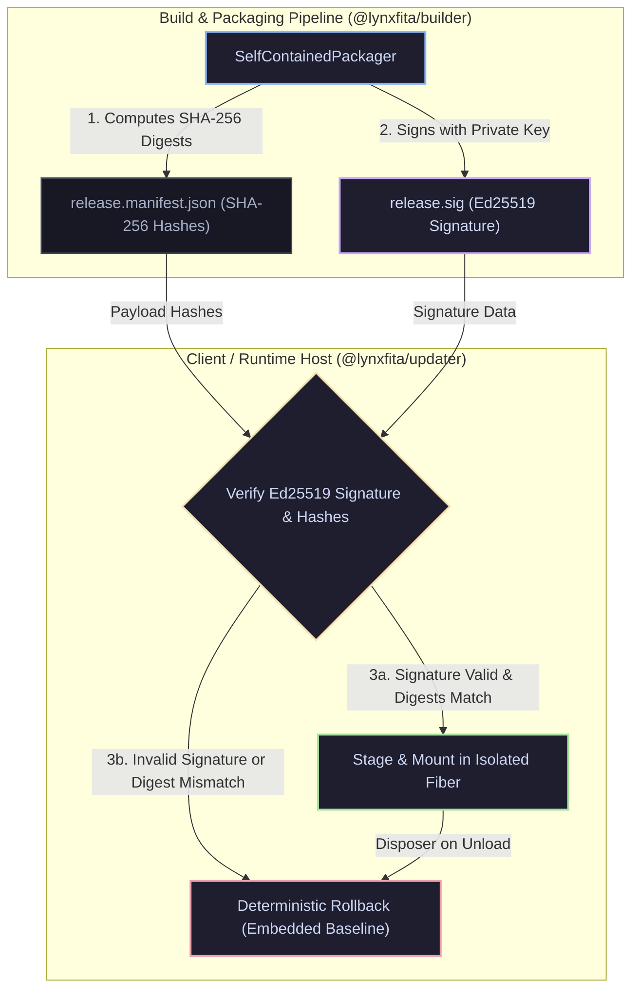
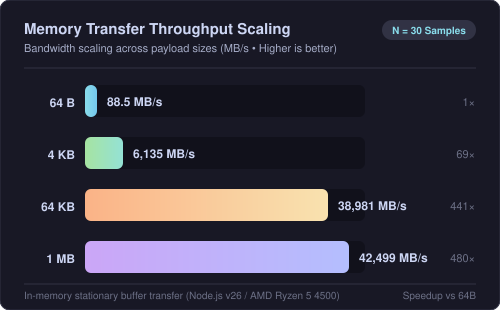

<h1 align="center">LynxFita</h1>

<p align="center">
  <strong>Modular Desktop Application Runtime Architecture for LynxJS</strong><br />
  <em>Cordis Microkernel Spine &bull; Meta Hermes C++20 JSI Engine &bull; Stationary Shared Memory &bull; Ed25519 Provenance</em>
</p>

<p align="center">
  <a href="https://opensource.org/licenses/Apache-2.0"></a>
  <a href="https://github.com/aleffita/lynxfita/actions"></a>
  <a href="https://en.cppreference.com/w/cpp/20"></a>
  <a href="https://pnpm.io/"></a>
  <a href="https://arxiv.org/abs/2608.25512"></a>
  <a href="https://donate.stripe.com/9B66oHaordEdf36erNfEk00"></a>
  <a href="https://github.com/sponsors/aleffita"></a>
</p>

<br />

---

## 1. Overview & Architecture

**LynxFita** is an open-source experimental desktop application runtime for LynxJS, exploring an endogenous microkernel architecture powered by **[Cordis](https://github.com/shigma/cordis)** ([`vendor/cordis`](vendor/cordis), [arXiv:2608.25512](https://arxiv.org/abs/2608.25512)).

### The Architectural Problem Space

In modern desktop application engineering, developers face structural trade-offs between monolithic web runtimes and native embedding:
- **Lynxtron (`vendor/lynxtron`)**: Pairs Node.js with Lynx (`LynxWindow`), utilizing Node-API and platform window plumbing.
- **LynxFita Approach**: Explores an endogenous Cordis capability seam model. Every subsystem—memory buffers, binary wire serialization, Meta Hermes bytecode execution, dynamic native libraries, and release integrity—is mounted as a revertible Cordis service on a unified context (`LynxFitaContext` in TypeScript and `lynxfita::cordis::NativeContext` in C++20).

```mermaid
flowchart TD
    classDef core fill:#1e1e2e,stroke:#89b4fa,stroke-width:2px,color:#cdd6f4
    classDef memory fill:#1e1e2e,stroke:#a6e3a1,stroke-width:2px,color:#cdd6f4
    classDef ffi fill:#1e1e2e,stroke:#fab387,stroke-width:2px,color:#cdd6f4
    classDef security fill:#1e1e2e,stroke:#cba6f7,stroke-width:2px,color:#cdd6f4
    classDef bundle fill:#181825,stroke:#45475a,stroke-width:1.5px,color:#a6adc8
    classDef surface fill:#1e1e2e,stroke:#f9e2af,stroke-width:2px,color:#cdd6f4

    subgraph Bundle["Self-Contained Relocatable Application Bundle"]
        Launchers["Portable Launchers (run.cmd / AppRun)"]:::bundle
        AppJson["Application Descriptor (lynxfita.app.json)"]:::bundle
        subgraph Payload["Embedded Distribution Payload"]
            Bytecode["bundles/ (Hermes HBC Bytecode)"]:::bundle
            Plugins["plugins/ (Native Shared Libraries .dll / .so)"]:::bundle
            Assets["assets/ (Static Media, Fonts & Themes)"]:::bundle
        end
        Manifest["release.manifest.json (SHA-256 Hashes)"]:::security
        Signature["release.sig (Ed25519 Signature)"]:::security
    end

    subgraph Host["Desktop Native Host (C++20 Engine)"]
        NativeEngine["lynxfita_explorer (.exe / ELF)"]:::core
        Verifier["Integrity Gate (Ed25519 & SHA-256)"]:::security
        MetaHermes["Meta Hermes JSI Runtime (hermesvm_a)"]:::core
        DmaArena["Stationary Shared Memory (64B Arena 0x2000)"]:::memory
        FfiLoader["Dynamic Native FFI (LoadLibraryExW / dlopen)"]:::ffi
    end

    subgraph Windowing["Native Desktop Surface"]
        LynxSurface["Declarative Lynx AST & Surface Window"]:::surface
    end

    Launchers -->|Spawns Host Process| NativeEngine
    NativeEngine -->|1. Verifies Signature| Verifier
    Signature -->|Signature Bytes| Verifier
    Manifest -->|Payload Hashes| Verifier
    Verifier -->|2. Validates Integrity| AppJson
    AppJson -->|3. Configures Context| NativeEngine
    NativeEngine -->|4. Allocates Stationary Memory| DmaArena
    NativeEngine -->|5. Initializes Engine| MetaHermes
    NativeEngine -->|6. Mounts Dynamic Loader| FfiLoader
    Bytecode -->|Maps HBC Payload| MetaHermes
    Plugins -->|Loads Shared Libraries| FfiLoader
    Assets -->|Supplies UI Resources| LynxSurface
    FfiLoader <-->|SIMD Operations| DmaArena
    MetaHermes <-->|JSI HostObject Bridge| DmaArena
    MetaHermes -->|7. Evaluates UI Tree| LynxSurface
    LynxSurface -->|8. Renders Native View| NativeEngine
```



### Runtime Execution Lifecycle

The desktop host evaluates compiled Meta Hermes bytecode and orchestrates native subsystems through zero-copy memory lanes:



### Cordis Capability Seams

Subsystems are implemented as Cordis **Services** with declared dependencies (`inject`) and lifecycle disposers (`ctx.effect()`):

| Capability Seam | TypeScript Service | C++20 Native Service | Material Implementation Status |
| :--- | :--- | :--- | :--- |
| **`ctx.dma`** | `DmaService` (`@lynxfita/core`) | `DmaEibEngine` (`dma_eib_engine.cc`) | 64-byte aligned stationary memory arena (`0x0000` telemetry, `0x1000` wire buffer, `0x2000` SIMD slot) with parallel worker lanes. |
| **`ctx.protobuf`** | `ProtobufService` (`@lynxfita/core`) | `ProtobufBridge` (`protobuf_bridge.cc`) | Varint and binary wire framing (`tag << 3 \| wire_type`) over shared memory slots. |
| **`ctx.ffi`** | `FfiService` (`@lynxfita/core`) | `NativeFfiLoader` (`native_ffi_loader.cc`) | Dynamic shared library loader (`LoadLibraryExW` on Win32, `dlopen` on POSIX) with automatic cleanup on Fiber unload. |
| **`ctx.compiler`** | `CompilerService` (`@lynxfita/core`) | `HermesRuntimeAdapter` & `compileJS` (`hermes_compiler.cc`) | Authentic Meta Hermes C++20 JSI adapter (`hermesapi`, `hermesvm_a`) and ahead-of-time bytecode compilation via `hermesc` (`compileWithHermesc`). |
| **`ctx.wasi`** | `WasiComponentService` (`@lynxfita/wasi-runtime`) | `WasiHostModule` (`wasi_host_module.cc`) | Linear memory interop and WIT interface parser (`@lynxfita/codegen`). *[Roadmap: Bytecode Alliance Wasmtime integration]*. |
| **`ctx.gpu`** | `GpuService` (`@lynxfita/core`) | — | WebGPU pipeline abstraction. *[Roadmap: Native Dawn/wgpu C++ backend dispatch]*. |
| **`ctx.federation`** | `FederationService` (`@lynxfita/updater`) | — | Validates release manifests and updates using Ed25519 digital signatures and SHA-256 digests. |

---

## 2. Desktop Shell & Application Showcases

Applications and plugins run in isolated Cordis Fibers (`ctx.isolate()`), acquiring resources via revertible effects:

<div align="center">
  
</div>

### MVI Unidirectional Architecture & Telemetry Lane

```mermaid
flowchart LR
    classDef ui fill:#1e1e2e,stroke:#f9e2af,stroke-width:2px,color:#cdd6f4
    classDef control fill:#1e1e2e,stroke:#89b4fa,stroke-width:2px,color:#cdd6f4
    classDef hardware fill:#1e1e2e,stroke:#a6e3a1,stroke-width:2px,color:#cdd6f4
    classDef native fill:#1e1e2e,stroke:#fab387,stroke-width:2px,color:#cdd6f4

    subgraph UI["Declarative Lynx Surface"]
        View["Lynx View Components (<view>, <text>)"]:::ui
        Intent["User Action / Trigger (Refresh, Select)"]:::ui
    end

    subgraph Control["Cordis Control Plane"]
        Store["WeatherStore (MVI Unidirectional Reducer)"]:::control
        State["Immutable WeatherState (Telemetry, Cities)"]:::control
    end

    subgraph Hardware["Stationary Shared Memory & FFI"]
        DMA["Stationary DMA Lane (Offset 0x2000)"]:::hardware
        Plugin["Native SIMD Plugin (.dll / .so)"]:::native
    end

    View -->|User Interaction| Intent
    Intent -->|dispatch(intent)| Store
    Store -->|Pure Reducer Function| State
    State -->|Renders Declarative AST| View
    Store -->|Zero-Copy DMA Synchronization| DMA
    DMA <-->|Vectorized In-Place Computation| Plugin
    Plugin -->|Telemetry Result Slot| Store
```

| Project / Showcase | Path | Description & Runtime Environment |
| :--- | :--- | :--- |
| **Desktop Shell Preview** | [`examples/explorer`](examples/explorer) | TypeScript interactive developer shell demonstrating Cordis service lifecycle, route navigation (`lynxfita://home`, `lynxfita://settings`), and memory slot inspection. Serves local preview at `http://127.0.0.1:4173` via `pnpm explore`. |
| **Weather Showcase MVI** | [`examples/weather-showcase`](examples/weather-showcase) | Unidirectional Model-View-Intent weather radar application with declarative Lynx components (`<view>`, `<text>`, `<image>`), dark/light themes (`#f9d65d`), 14 weather conditions, and SIMD telemetry integration. |
| **WIT & Native SIMD Studio** | [`examples/explorer/src/miniapps/wit_ffi_studio_miniapp.ts`](examples/explorer/src/miniapps/wit_ffi_studio_miniapp.ts) | Interactive WebAssembly Interface Type (WIT) parser (`parseWitSpec`) and SIMD execution interface over memory slot `0x2000`. |
| **Stationary DMA Lab** | [`examples/explorer/src/miniapps/dma_gpu_lab_miniapp.ts`](examples/explorer/src/miniapps/dma_gpu_lab_miniapp.ts) | Memory slot visualizer (`0x0000`–`0x3FFF`) and canvas visualization. |
| **`lynxfita_explorer` Native Host** | [`src/native/src/explorer_main.cc`](src/native/src/explorer_main.cc) | Desktop application host binary executing compiled Hermes bytecode bundles via `--run <file.hbc>` and interactive desktop window via `--gui [bundle.hbc]`. |

<p align="center">
  
  
</p>

---

## 3. Release Provenance & Cryptographic Integrity

LynxFita incorporates digital signatures for **binary release integrity** and **over-the-air update verification**:



1. **Signed Release Manifests (`@lynxfita/builder`)**: The packaging pipeline generates `release.manifest.json` containing SHA-256 digests for all bundle payloads, native binaries, and dynamic libraries, signed with an Ed25519 private key (`release.sig`).
2. **Cryptographic Verification (`@lynxfita/updater`)**: The updater service verifies the digital signature against the embedded public key and validates payload SHA-256 hashes prior to staging updates.
3. **Deterministic Rollback (`ctx.federation`)**: If a remote bundle fails verification or encounters an unhandled fault, the reconciler unloads the affected Fiber and restores the embedded baseline bundle.

---

## 4. Performance & Microbenchmarks

Statistical microbenchmarks are executed via `pnpm bench` ([`benchmarks/run_benchmarks.ts`](benchmarks/run_benchmarks.ts)) using the Kalibera & Jones standard ($N = 30$ independent sample batches after 10 discarded warm-up rounds).

Full methodology and raw statistical distributions ($p50$, $p95$, $p99$, $IQR$, $CV\%$, 95% CI): [`BENCHMARK.md`](BENCHMARK.md).

> **Measurement Context Note**: The charts and metrics below reflect memory operations executed on Node.js v26.12.1 (`AMD Ryzen 5 4500 6-Core Processor`, `Windows NT 10.0.19045 x64`). High throughput metrics represent in-memory V8 TypedArray buffer operations, not hardware peripheral DMA transfers.

<p align="center">
  
  
</p>

### High-Signal Metric Overview

| Subsystem & Operation | Payload Range | Median Latency ($p50$) | Peak Bandwidth | Measurement Baseline |
| :--- | :---: | :---: | :---: | :--- |
| **Stationary Memory Transfer** | `64 B` &ndash; `1 MB` | `0.60` &ndash; `23.10 μs` | `42,498.94 MB/s` | V8 TypedArray / in-memory stationary arena |
| **SIMD Float32 Vector Lane** | `16 B` | `0.36 μs` | `38.22 MB/s` | IEEE 754 float32 DataView vector lane |
| **Protobuf Wire RPC Encoding** | `64 B` &ndash; `4 KB` | `7.70` &ndash; `9.60 μs` | `319.57 MB/s` | Binary wire varint packing over memory slot |
| **WASI Linear Memory Interop** | `64 B` &ndash; `1 MB` | `0.50` &ndash; `285.20 μs` | `3,268.29 MB/s` | Sandboxed WASI memory bounds checking |

---

## 5. Quick Start & Developer Workflow

### Prerequisites
- Windows 10/11 (x64), Linux (Ubuntu 22.04+), or macOS (arm64)
- Node.js (v22.6+ with `--experimental-strip-types`) & pnpm (v10+)
- CMake (3.20+) & C++20 compiler (MSVC 2022/2026, Clang 16+, or GCC 13+)

### Build & Verification Commands

```bash
# 1. Install dependencies & materialize workspace links
pnpm install

# 2. Compile all TypeScript workspaces
pnpm build

# 3. Run verification test suites
pnpm test

# 4. Build and execute native C++20 engine test runner
pnpm test:native

# 5. Launch the developer preview shell at http://127.0.0.1:4173
pnpm explore

# 6. Run statistical benchmarks
pnpm bench

# 7. Package self-contained desktop application (AppImage/PE layout with Ed25519 signature)
node --experimental-strip-types scripts/package-release.ts
```

---

## 6. Monorepo Organization & Subtree Governance

Each subtree is governed by an authoritative local `AGENTS.md` indexer:

```
lynxfita/
├── AGENTS.md                # Root standing orders & Cordis capability seam contract
├── BENCHMARK.md             # Kalibera & Jones statistical benchmark report
├── .agents/                 # Specialist agent skills (archify, dsh-prose-standard, record-browser-gif)
├── benchmarks/              # N = 30 statistical benchmark harness & JSON provenance (benchmarks/AGENTS.md)
├── docs/                    # Architecture documentation, Cordis primer, transcripts & glossary (docs/AGENTS.md)
├── examples/                # Application showcases & developer preview (examples/AGENTS.md)
│   ├── explorer/            # Developer preview shell host & miniapps
│   ├── weather-showcase/    # MVI weather application with telemetry sync
│   └── plugins/             # Dynamic shared library plugins (weather-simd)
├── packages/                # TypeScript Cordis workspaces (packages/AGENTS.md)
│   ├── core/                # LynxFitaContext, Fiber, Service, Shared Memory & Wire Codec
│   ├── codegen/             # WIT universal module IR parser & generator
│   ├── wasi-runtime/        # WASI memory management service
│   ├── builder/             # Distribution packager & Ed25519 manifest signer
│   ├── updater/             # Release integrity & signature verification service
│   └── cli/                 # Development lifecycle CLI
├── scripts/                 # Workspace setup, native build/test & docs verifier
├── src/native/              # C++20 NativeContext, LoadLibraryExW/dlopen FFI & test runner
├── tests/                   # Cross-package integration and lifecycle test suites
└── vendor/                  # Pinned upstream submodules (cordis, hermes, lynx, lynxtron...)
```

---

## 7. Backing the Research & Patronage

<div align="center">

### 🖤🐧 *"Enjoyed the session? Satisfied with how I perform?"*

*Help keep a working girl's late-night research alive by tipping any amount. Who knows — I might spin up a private dashboard and unlock exclusive behind-the-scenes builds for my top patrons. No promises, just immeasurable value to keep the sessions going!*

<br />

[](https://donate.stripe.com/9B66oHaordEdf36erNfEk00)&nbsp;&nbsp;&nbsp;[](https://github.com/sponsors/aleffita)

</div>

---

## 8. License

Licensed under the **Apache-2.0 License**. See [LICENSE](LICENSE) for details.
