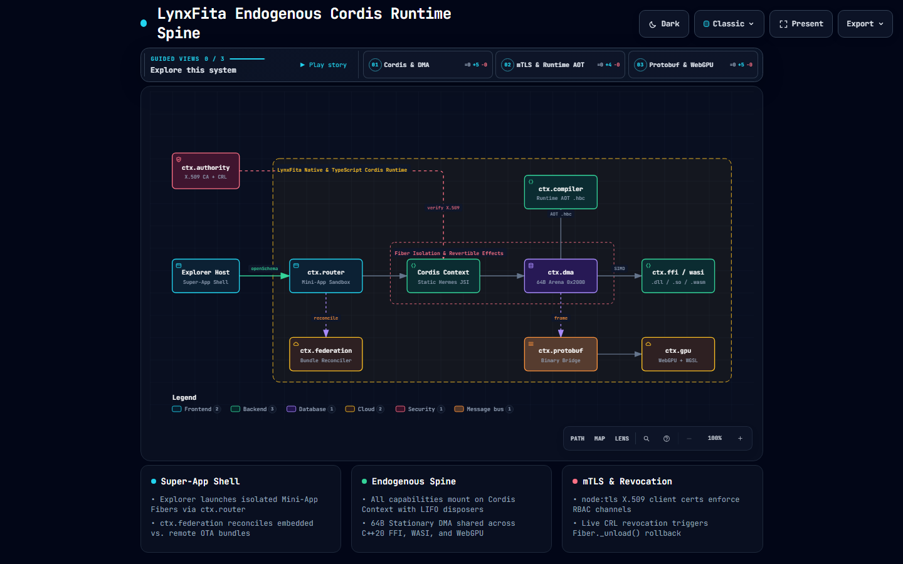
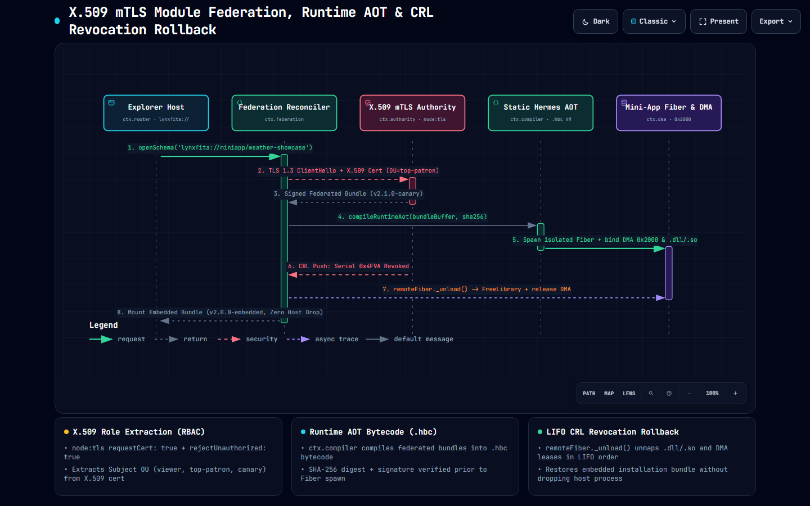

# Cordis Endogenous Runtime Primer

LynxFita uses [Cordis](https://github.com/shigma/cordis) ([`vendor/cordis`](../vendor/cordis), [arXiv:2608.25512](https://arxiv.org/abs/2608.25512)) as its endogenous runtime spine across both the TypeScript control plane (`LynxFitaContext`) and the C++20 native engine (`lynxfita::cordis::NativeContext`). Every runtime capability is mounted as a Cordis **Service** with explicit `inject` coeffects and revertible `ctx.effect()` disposers.



Interactive viewer: [`docs/architecture/cordis-spine.html`](architecture/cordis-spine.html)

---

## 1. Capability Seam Anatomy

Every capability in LynxFita follows a three-part seam contract:

1. **Service Key & Contract**: Declares the typed property on `Context` (for example `ctx.dma`, `ctx.compiler`, `ctx.ffi`, `ctx.wasi`, `ctx.authority`, `ctx.federation`).
2. **Service Provider (`Service` subclass)**: Owns the lifecycle of the underlying resource (a 64-byte-aligned Stationary DMA arena, a `node:tls` X.509 mTLS listener, or a `LoadLibraryExW` / `dlopen` native handle) and registers teardown hooks via `this.ctx.effect()`.
3. **Consumer Plugin**: Declares required upstream services via `static inject = ['dma', 'compiler']` and runs only after all injected dependencies are active in the current `Fiber`.

```ts
import { LynxFitaContext, Service } from '@lynxfita/core';

export class WeatherSimdConsumer extends Service {
  static override readonly inject = ['dma', 'ffi', 'gpu'] as const;

  constructor(ctx: LynxFitaContext) {
    super(ctx, 'weatherSimd');
    this.ctx.effect(() => {
      const slot = this.ctx.dma.allocateSlot(0x2000, 1024);
      return () => this.ctx.dma.releaseSlot(slot);
    });
  }
}
```

---

## 2. Mounted Capability Seams

| Service Key | TypeScript Provider (`packages/`) | C++20 Provider (`src/native/`) | Responsibility |
| :--- | :--- | :--- | :--- |
| `ctx.dma` | `DmaService` (`@lynxfita/core`) | `NativeDmaService` (`stationary_dma.cc`) | 64-byte-aligned Stationary DMA arena (`0x0000` telemetry, `0x1000` Protobuf wire, `0x2000` weather & shader uniforms), PPE/SPE ring lanes, SIMD reductions. |
| `ctx.protobuf` | `ProtobufService` (`@lynxfita/core`) | `NativeProtobufService` (`protobuf_frame.cc`) | Zero-JSON binary wire framing (`tag << 3 | wire_type`) over `ctx.dma`. |
| `ctx.compiler` | `CompilerService` (`@lynxfita/core`) | `NativeCompilerService` (`hermes_compiler.cc`) | Static Hermes ahead-of-time (`.hbc`) and runtime JIT/AOT compilation + register/stack VM execution. |
| `ctx.ffi` | `FfiService` (`@lynxfita/codegen`) | `NativeFfiLoader` (`native_ffi_loader.cc`) | Cross-platform shared library loader (`LoadLibraryExW` on Windows, `dlopen` on Linux/macOS) with automatic `FreeLibrary`/`dlclose` on Fiber unload. |
| `ctx.wasi` | `WasiService` (`@lynxfita/wasi-runtime`) | `WasiHostModule` (`wasi_host_module.cc`) | WIT (WebAssembly Interface Types) universal module IR and LEB128 Wasm binary interpreter over `ctx.dma`. |
| `ctx.gpu` | `WebGpuService` (`@lynxfita/core`) | — | W3C WebGPU two-buffer staging, WGSL compute shaders, and `huggingface/kernels` catalog dispatch. |
| `ctx.authority` | `MtlsAuthorityServer` (`@lynxfita/updater`) | — | Real `node:tls` X.509 mTLS server (`requestCert: true`), role extraction (`viewer`, `top-patron`, `canary`), and live Certificate Revocation List (CRL). |
| `ctx.federation` | `FederationService` (`@lynxfita/updater`) | — | Reconciles embedded installation bundles vs. remote federated bundles and triggers `Fiber._unload()` rollback on CRL revocation. |
| `ctx.router` | `ExplorerRouterService` (`examples/explorer`) | — | WeChat-style Super-App scheme router (`lynxfita://miniapp/<id>`) launching isolated Mini-App Fibers. |

---

## 3. Revertible Effects & Deterministic CRL Rollback

All resource registrations inside a Mini-App container execute inside an isolated Cordis `Fiber` (`ctx.isolate()`). When a Mini-App unloads—or when `ctx.authority` pushes a Certificate Revocation List (CRL) update revoking the active X.509 client certificate serial—`ctx.federation` invokes `remoteFiber._unload()`:



Interactive viewer: [`docs/architecture/mtls-federation.html`](architecture/mtls-federation.html)

1. `ctx.gpu` releases WebGPU staging buffers.
2. `ctx.wasi` unmaps linear memory views bound to `ctx.dma`.
3. `ctx.ffi` calls `FreeLibrary` (Windows) or `dlclose` (POSIX) on native `.dll`/`.so`/`.dylib` handles.
4. `ctx.dma` zeroes and returns Stationary DMA slots (`0x2000`) to the arena allocator.
5. `ctx.federation` mounts the verified embedded installation bundle without dropping the Explorer host process.
