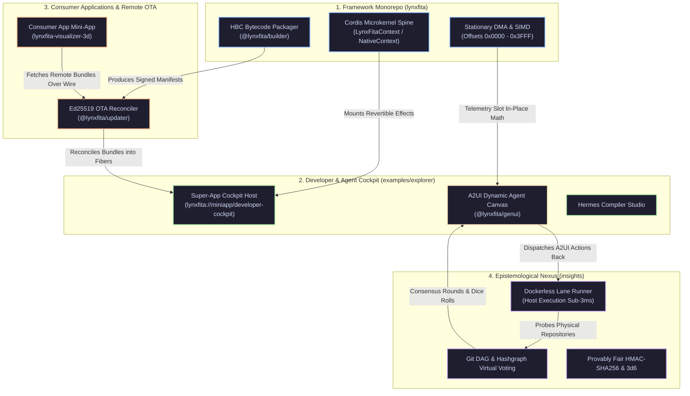
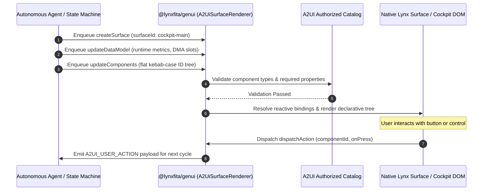

# Grand Unified Agentry Cockpit & Multi-Repo Federation Protocol

This specification establishes the unified operational model uniting the **LynxFita Framework Monorepo**, the **Super-App Developer Cockpit**, the **Remote Module Federation Reconciler**, **ByteDance/Lynx A2UI GenUI**, and the **Git State Machine Orchestrator**.



---

## 1. Architectural Problems and the Unification Principle

Prior to this specification, development across autonomous agents and human systems engineers suffered from fragmented operational surfaces:
- **CLI Isolation**: Tools ran strictly as terminal scripts, preventing live visual introspection of runtime fibers, memory slots, and consensus rounds.
- **Local vs. Remote Bundle Disconnect**: Bundles were either hardcoded in monorepo directories or theoretical remote endpoints, lacking an integrated environment demonstrating both local baseline execution and cryptographically verified remote downloads.
- **Unconstrained Generative UI Hazards**: LLM-generated UIs typically attempted to synthesize arbitrary React or JavaScript strings, leading to parser errors, security sandbox violations, and unmaintainable interfaces.

The **Grand Unified Cockpit** resolves these fractures by anchoring all operations to an endogenous **Cordis Microkernel Spine** and an authorized **A2UI v0.9 Catalog**.

---

## 2. ByteDance / Lynx A2UI v0.9 Specification Integration

Following the official ByteDance and Google Lynx GenUI standards (`vendor/lynx-website/docs/en/react/genui/a2ui.mdx`), [`@lynxfita/genui`](file:///j:/limiar/packages/lynxfita/packages/genui) enforces a catalog-constrained UI generation pipeline:



### Key Protocol Invariants:
1. **Zero Arbitrary Execution**: Agents NEVER emit executable JavaScript or HTML snippets. All generated cards must validate against [`LynxFitaCockpitCatalog`](file:///j:/limiar/packages/lynxfita/packages/genui/src/catalog.ts) (`Container`, `Card`, `Metric`, `Button`, `StatusBadge`, `MemorySlotView`, `DagNode`, `CodeBlock`).
2. **Flat Component Graph**: Components reference children by string ID rather than deep nesting, enabling minimal AST diffs during incremental updates.
3. **Reactive Data Model Bindings**: Properties using `"$bind:propName": "model.path"` dynamically re-render when `updateDataModel` messages arrive, avoiding full DOM reconstruction.

---

## 3. Remote Module Federation & OTA Reconciler Protocol

The Super-App Explorer incorporates [`@lynxfita/updater`](file:///j:/limiar/packages/lynxfita/packages/updater) to establish dual-mode bundle execution:

| Bundle Type | Storage & Distribution | Security Verification | Fault Tolerance Mechanism |
| :--- | :--- | :--- | :--- |
| **Embedded Baseline** (`1.0.0-embedded`) | Compiled directly into the host binary distribution. | Hermetically packaged with verified build hash. | Default immutable fallback for safe operation. |
| **Remote Federated** (`2.3.0-remote`) | Fetched dynamically from remote CDN or release artifact. | Ed25519 digital signature and SHA-256 payload checksum. | If verification fails, reconciler unloads the Fiber and falls back to baseline. |

### Deterministic Rollback Contract:
```typescript
const result = await federationService.reconcile(remoteBundle, signatureHex, trustedPublicKeyPem);
if (!result.signatureValid) {
  // 1. Log cryptographic verification failure
  // 2. Unload compromised or corrupted child Fiber
  // 3. Mount embedded baseline in clean isolated Context
}
```

---

## 4. Multi-Repo Co-Evolution Matrix

The three repositories interact as an interdependent ecosystem:

```
┌─────────────────────────────────┐
│ 1. Framework: lynxfita          │
│    - Core JSI & Cordis runtime  │
│    - Developer Cockpit Shell    │
└────────────────┬────────────────┘
                 │ Releases SDKs & HBC Packager
                 ▼
┌─────────────────────────────────┐       Consensus Rounds       ┌─────────────────────────────────┐
│ 2. Consumer: visualizer-3d      │◄─────────────────────────────┤ 3. Nexus: insights              │
│    - Standalone 3D Mini-App     │   Provably Fair Die Rolls    │    - Git DAG Virtual Voting     │
│    - WebGPU WGSL compute        │   Automated Lane Pipelines   │    - Fastlane Host Runner       │
└─────────────────────────────────┘                              └─────────────────────────────────┘
```

1. **Framework Monorepo (`lynxfita`)**: Maintains core host engines, memory layouts, and toolset packages (`@lynxfita/core`, `@lynxfita/genui`, `@lynxfita/builder`, `@lynxfita/updater`).
2. **Consumer Application (`lynxfita-visualizer-3d`)**: Exercises the SDK in a real-world scenario (3D compute shaders, particle advection), dogfooding remote federation and submitting friction PRs.
3. **Epistemological Nexus (`insights`)**: Orchestrates multi-agent state progression via Git DAG virtual voting, provably fair rolls, and sub-3ms host pipeline lanes.

---

## 5. Developer & Agent Cockpit Interface Guide

The Developer Cockpit is accessible in the Super-App Explorer via:
```bash
pnpm explore
# Navigate to: lynxfita://miniapp/developer-cockpit
```

### Supported Cockpit Panes:
- **Workspace Overview**: Inspects status of `lynxfita`, `visualizer-3d`, and `insights`.
- **Remote Federation & OTA**: Live testbed for downloading remote manifests and triggering deterministic signature rollbacks.
- **A2UI Agent Canvas**: Live surface consuming A2UI v0.9 JSON messages, rendering real-time metrics and routing action events.
- **Hermes AOT Compiler**: Interactive bytecode studio executing [`BundlePackager.packageHermesBundle`](file:///j:/limiar/packages/lynxfita/packages/builder/src/bundle_packager.ts).
- **State Machine & DAG**: Inspects consensus rounds, DAG reachability, and 3d6 roll distributions.
